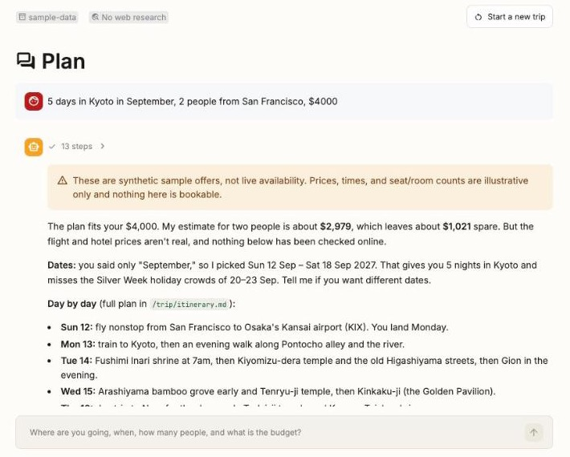
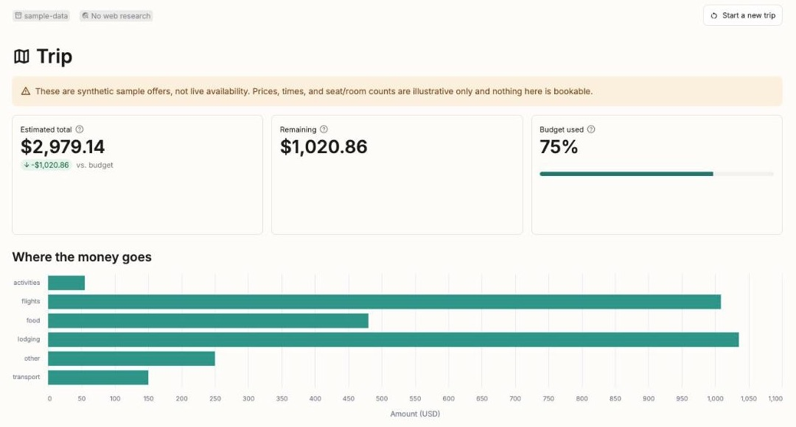

# Travel Agent

[](https://github.com/darylalim/travel-agent/actions/workflows/ci.yml)

Multi-agent travel planner on Deep Agents. It researches destinations, searches
flights and stays via Duffel, builds a costed day-by-day itinerary, and remembers
traveler preferences across conversations.

Two things it will not do:

- **It never books.** It searches and reads, and takes no payment, on a test
  token or a live one.
- **It never shows sample data as real.** Every offer says whether it is
  synthetic, and the chat and the Trip page both carry that label.

## Setup

```bash
uv sync
cp .env.example .env   # then fill in ANTHROPIC_API_KEY
```

Only `ANTHROPIC_API_KEY` is required. Without `TAVILY_API_KEY` the agent still
plans, costs, and writes itineraries, but it cannot research anything on the web.

## Run

```bash
uv run langgraph dev                     # LangGraph Studio at :2024, the main way to run it
uv run streamlit run streamlit_app.py    # browser UI at :8501
uv run python -m travel_agent.main '5 days in Kyoto in September, 2 people, $4000'
```

`langgraph dev` is the recommended path, because it shows a visual trace of every
subagent call.

All three keep the traveler profile across runs, but not in the same place:

- **`langgraph dev`** uses storage supplied by the server.
- **The CLI and the browser UI** share one unencrypted SQLite file holding your
  profile and trips. It defaults to `~/.travel-agent/travel-agent.sqlite`, and
  `TRAVEL_AGENT_DB` moves it.

A profile written in one does not appear in the other.

Each CLI run starts a new trip and prints a thread id. Pass it back with
`--thread` to resume that trip, and the agent is told how old its prices are.

### Browser UI

The UI saves each trip after every reply. It has three pages:

- **Plan:** chat with the agent. Its prose streams in, with tool calls in a
  collapsed activity trail.
- **Trip:** the same trip as figures: budget, cost by category, flight and
  lodging tables, and the itinerary. A control switches between searches, such
  as nearby airports or shifted dates. They stay separate because a merged list
  would rank a cheaper flight on other dates above the dates you asked for.
- **Past trips:** reopen a trip or delete one, apart from the trip that is open.
  A reopened trip comes back as saved, and the Trip page says its prices date
  from then. CLI trips are not listed, because the CLI does not capture the
  search results this page restores.

Every synthetic result is labeled in its table and repeated in a standing
notice at the top of the Trip page.

The screenshots below come from a real run on sample data, so the fares are
synthetic and the notice says so.





### Tracing

Set `LANGSMITH_API_KEY` in `.env` and every entry point traces to LangSmith, with
each subagent call nested under the main agent's. `.env.example` already sets
`LANGSMITH_TRACING=true` and `LANGSMITH_PROJECT=travel-agent`.

A trace records full inputs and outputs: the traveler profile, the prompts, and
every offer payload, including live Duffel fares. Set
`LANGSMITH_TRACING=false` if that should not leave the machine. The test suite
never traces.

## How it works

`create_deep_agent` supplies a filesystem and delegation (`task`). This project
adds the pieces below. Modules are under `src/travel_agent/`, and the Streamlit
entry point and pages are at the repo root.

| Piece | Where | What it does |
|---|---|---|
| System prompts | `prompts.py` | Workspace layout, memory contract, delegation rules |
| Subagents | `subagents.py` | `destination-researcher`, `availability-scout`, `budget-analyst` |
| Models | `config.py` | Model and effort for the main agent and each subagent |
| Web search | `tools/search.py` | Tavily, optional |
| Flights and lodging | `tools/availability.py`, `tools/duffel.py`, `tools/duffel_stays.py` | Provider seam, described under [Flight and lodging sources](#flight-and-lodging-sources) |
| Budget math | `tools/budget.py` | Pure arithmetic, so the model never adds up a column itself |
| Graph | `agent.py` | Wires the above together and exports `graph` for `langgraph.json` |
| Persistence | `persistence.py` | The SQLite checkpointer and store for the CLI and browser UI |
| Browser UI | `streamlit_app.py`, `app_pages/` | Three-page Streamlit app, themed in `.streamlit/config.toml` |
| UI runtime | `ui.py` | Cached agent, turn streaming, and saved trips |

### Storage

A `CompositeBackend` splits the agent's filesystem in two:

- **`/trip/*`** goes to `StateBackend`, scoped to one conversation. It holds the
  brief, research notes, options, and itinerary.
- **`/memories/*`** goes to `StoreBackend`, shared across conversations. It holds
  `traveler_profile.md`, which is loaded into the system prompt at startup and
  skipped on a first run, when it does not exist yet.

## Flight and lodging sources

`tools/availability.py` defines an `AvailabilityProvider` protocol. Pick a source
with `TRAVEL_AGENT_PROVIDER`:

| Value | Flights | Lodging |
|---|---|---|
| `sample-data` (default) | Synthetic | Synthetic |
| `duffel` with a test token | Synthetic (Duffel test inventory) | Synthetic (sample data) |
| `duffel` with a live token | **Real** | **Real** (Duffel Stays) |

Every offer carries `synthetic: bool`, and a response with synthetic offers
carries a `warning`. An empty result gets the warning too, or "no offers" from a
synthetic source would read as "we checked real inventory".

The agent keys off those two fields, never the provider name, because `duffel`
can be either. A test token returns fictional airlines at invented fares from a
live API, while a live token returns real inventory.

To enable Duffel, create a test token in the Duffel dashboard under *Developer
test mode* (`duffel_test_…`), then set `DUFFEL_API_TOKEN` and
`TRAVEL_AGENT_PROVIDER=duffel` in `.env`.

**Duffel is read-only.** It never calls `POST /air/orders` or
`POST /stays/bookings` and never creates a quote, and `tests/test_no_booking.py`
enforces this. Adding booking would mean putting order creation behind Deep
Agents' `interrupt_on` human-approval gate, a deliberate decision rather than a
config change.

Worth knowing:

- **Offers expire, usually in minutes.** Each carries `expires_at` and
  `expires_in_seconds`, and the agent searches again rather than quote a stale
  one.
- **Results are capped at 20 offers.** The trim keeps the cheapest, fastest, and
  fewest-stops options, so a nonstop survives when the cheapest fares are all
  multi-stop. Responses carry `total_found`, `count`, and a `truncated` note.
- **Cabin is a preference, not a filter.** It defaults to economy, each offer
  carries the cabin it came back in, and a `cabin_note` flags a mismatch.
- **Live lodging search covers a fixed list of cities.** Duffel Stays searches by
  coordinates, so an unknown city is an error naming the ones that work, not a
  guess at the nearest.
- **A stay's two prices are reported, never summed.** Duffel's docs disagree
  about whether `due_at_accommodation_amount` sits inside `total_amount`.
- **Lodging search is one room for all guests.** Multi-room search is out of
  scope.

Duffel's REST API is called directly over `httpx`, because the `duffel-api` PyPI
package was last released in 2023, is classified Alpha, and would add a
`requests` dependency.

To add a provider, such as Amadeus or Booking.com, implement the protocol,
register a factory in `_PROVIDERS`, and set `source` and `synthetic` on each
offer.

## Evaluations

`evals/` holds nine LangSmith datasets, and `evals/run.py` scores them against
the real models. They need `LANGSMITH_API_KEY` and spend real tokens.

| Sets | What they are for |
|---|---|
| Regression: `final_response`, `trajectory`, `availability_scout`, `budget_analyst` | Catching breakage in replies, delegation, and each subagent |
| `_hard` | Briefs a plausible agent gets wrong, run with `--repetitions` for a pass rate |
| `_scripted` | Inventory and research sample data never produces, such as a cabin downgrade or partly failed research |

```bash
uv run python -m evals.upload --dry-run                          # validate the datasets, no keys needed
uv run python -m evals.upload                                    # upload any not already in LangSmith
uv run python -m evals.run budget_analyst --limit 1 --no-judge   # cheapest real run, a few cents
uv run python -m evals.run trajectory --limit 1                  # one full trip, about $1
uv run python -m evals.run budget_analyst_hard --repetitions 3   # a pass rate, about $0.50
```

Pass `--no-web-search` if Tavily is out of credits. Each run also writes its
transcripts and scores to `evals/results/`, which is gitignored.

## Develop

```bash
uv run pytest                     # no token, model calls, or network needed
uv run ruff check .
uv run ruff format .
uv run ty check
bash .claude/hooks/test-hooks.sh  # the Claude Code hooks under .claude/
```

CI runs the same checks on push and pull request, with tests on Python 3.11 and
3.13, the two ends of the supported range, and the hook suite on Linux and macOS.

### Releasing

Bump `[project] version` in `pyproject.toml` and push to `main`. Once the checks
pass, CI tags that commit `vX.Y.Z` and publishes a GitHub release whose notes are
the commit subjects since the previous tag.

Nothing is uploaded to a package index, because the PyPI name `travel-agent`
belongs to an unrelated project.

## Stack

Requires Python 3.11+.

- **Agent:** `deepagents` 0.7.x, `langchain` 1.3+, `langgraph` 1.2+
- **Models:** `claude-opus-5-5` (main agent), `claude-sonnet-5-5` and
  `claude-haiku-5-5` (subagents), via `langchain-anthropic`
- **Inventory:** Duffel API `v2` over `httpx`
- **UI:** `streamlit` 1.60+

## License

MIT, see [LICENSE](LICENSE). The runtime stack is permissive: `deepagents`,
`langchain`, and `langgraph` are MIT, `httpx` and `python-dotenv` are
BSD-3-Clause, and `streamlit` is Apache-2.0.

The dev environment is the exception. `langgraph-cli[inmem]`, which runs
`langgraph dev`, brings in `langgraph-api` and `langgraph-runtime-inmem`
(Elastic-2.0, which restricts offering the software to others as a hosted or
managed service) and `forbiddenfruit` (metadata lists both GPLv3+ and MIT). None
of them is a runtime dependency.
